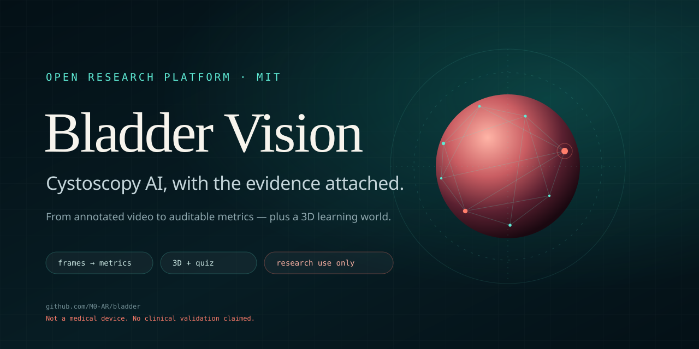
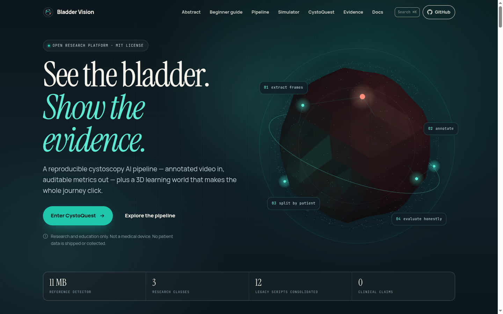
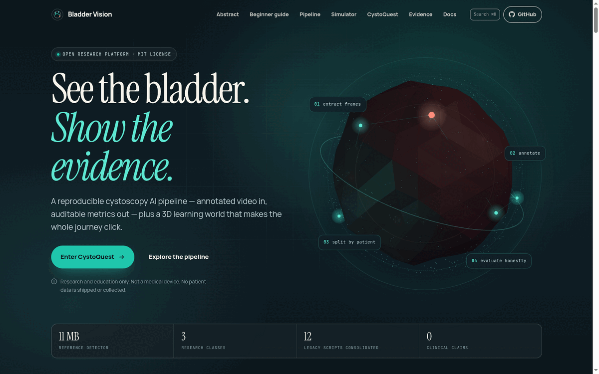
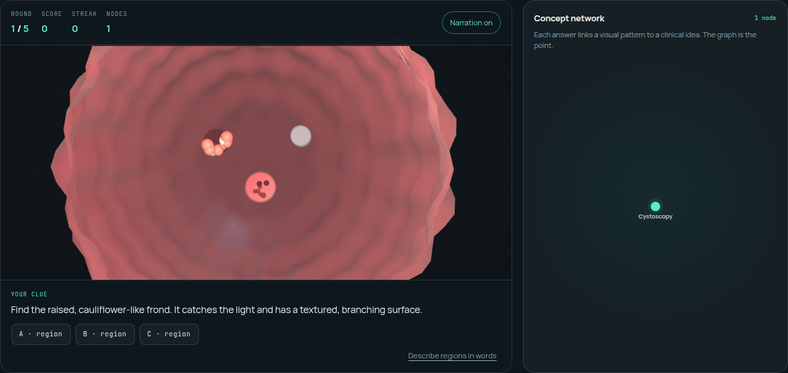
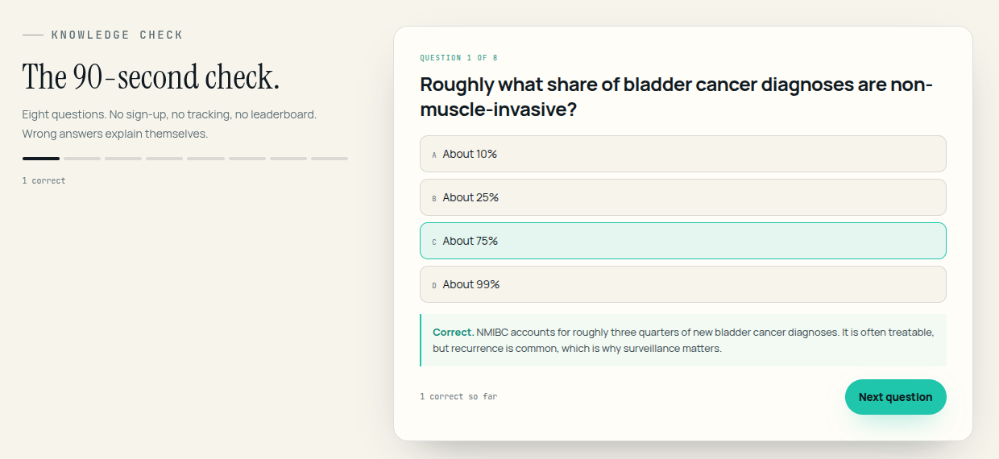

<div align="center">
  
</div>

<h1 align="center">Bladder Vision</h1>

<p align="center">
  <strong>Cystoscopy AI, with the evidence attached.</strong><br>
  Annotated video in. Auditable metrics out. Plus a 3D learning world that makes the pipeline click.
</p>

<p align="center">
  <a href="https://m0-ar.github.io/bladder/"></a>
  
  <a href="LICENSE"></a>
  <a href="https://github.com/M0-AR/bladder/actions/workflows/ci.yml"></a>
</p>

## The abstract

**A cystoscopy produces a video. A clinical decision needs evidence.**

Bladder cancer is one of the most common cancers worldwide, and most new diagnoses are non-muscle-invasive. That is good news for patients and a hard problem for software: the disease recurs, surveillance becomes a long relationship, and every judgement depends on what the operator saw, with which scope, under which light, at which moment.

Bladder Vision is an open, MIT-licensed research pipeline that turns annotated cystoscopy video into software you can inspect: extracted frames, converted annotations, seeded dataset splits with written manifests, a trainable frame classifier, a single-class TensorFlow Lite detector, and metrics a clinical reader can actually evaluate — sensitivity, specificity, predictive values, and a confusion matrix.

Every stage is a file contract. Every result is traceable to a seed, a split, a threshold, and a commit. The repository also ships an interactive site with a 3D bladder wall, a threshold laboratory, a lesion-recognition game, and a knowledge check. The point is not to impress you with a demo. The point is to make the reasoning visible.

**Nothing here is a medical device, and the project says so before you have to ask.**

### What this is — and what it is not

| This repository is | This repository is not |
|---|---|
| A reproducible research pipeline | A medical device or clinical decision tool |
| A file-contract toolkit: frames, XML, JSON, CSV | A hosted diagnostic service |
| A single-class TFLite reference detector | A validated cancer detector |
| A trainable three-class research classifier | A shipped, trained classifier |
| An evaluation checklist and a 3D teaching layer | Evidence of clinical or regulatory validity |

---

## Contents

- [🌱 Beginner Guide — Read This and You Are a Professional](#-beginner-guide--read-this-and-you-are-a-professional)
- [The pipeline](#the-pipeline)
- [The interactive site](#the-interactive-site)
- [Quick start](#quick-start)
- [Command reference](#command-reference)
- [Evidence and honest limits](#evidence-and-honest-limits)
- [Model facts](#model-facts)
- [Reproducibility](#reproducibility)
- [Project structure](#project-structure)
- [Documentation](#documentation)
- [Development](#development)
- [Citation](#citation)
- [License](#license)
- [Medical disclaimer](#medical-disclaimer)

---

## 🌱 Beginner Guide — Read This and You Are a Professional

No medical degree. No machine-learning PhD. Seven ideas, in the order they actually matter.

You will know more than most interview candidates.

### 1. Cystoscopy is the front door

A thin scope enters through the urethra and looks at the bladder wall. The result is a video, not a single photo. Lighting, angle, and the operator's hand all change what you see.

**Why it matters:** the model sees frames, but the clinician sees a procedure.

### 2. Annotations turn pixels into labels

A clinician draws a box around a suspicious region and attaches a label. That box is a claim about the world. If the box is wrong, the model learns the wrong lesson efficiently.

**Why it matters:** annotation quality is a ceiling on model quality.

### 3. A dataset is a curated textbook

Images plus labels are the examples. A dataset is not neutral: it reflects who was imaged, on which device, at which hospital, and who decided what counted as disease.

**Why it matters:** "works on my dataset" is a statement about the dataset first.

### 4. Split by patient, not by frame

Frames from one procedure look alike. If some go into training and others into test, the model can memorise the patient and look brilliant. That is leakage, not learning.

**Why it matters:** a patient-level split is the difference between a demo and evidence.

### 5. The model finds patterns, not meaning

A convolutional network learns textures, edges, colours, and shapes. It does not know what cancer is. It knows which pixel patterns were labelled cancer in the data it saw.

**Why it matters:** domain shift is not a bug; it is the default.

### 6. One accuracy number is a red flag

Sensitivity asks how many true cases you found. Specificity asks how many healthy cases you cleared. PPV and NPV depend on how common the disease is in the room. Always ask for the confusion matrix.

**Why it matters:** the threshold is a choice, and the choice has consequences.

### 7. A model is not a product

Clinical use needs a defined intended use, external validation, human-factors evidence, quality systems, cybersecurity, and a regulatory pathway. A notebook is the beginning of that work, not the end.

**Why it matters:** "the AUC is high" has never treated a patient.

### The one thing: ask "compared with what?"

Compared with a second cystoscopy? With histopathology? With a generalist? With the same model at a different threshold? The comparison is the claim.

**Why it matters:** precision without a reference is decoration.

> You do not need to trust the model. You need to be able to inspect the claim. That is a skill, and it is learnable in an afternoon.

---

## The pipeline

Six stages. Each one has an input, an output, and a reason to exist.

| Stage | Command | Contract |
|---|---|---|
| 01 · Capture frames | `extract-frames` | Video + timestamped annotations → PNG frames + optional VOC sidecars |
| 02 · Annotate boxes | `convert-annotations` | VIA JSON + frames → Pascal VOC XML |
| 03 · Split manifest | `split-classification`, `split-detection` | Class folders or image/annotation pairs → seeded train/validation/test + `split_manifest.json` |
| 04 · Learn model | `train-classifier` | Dataset → Keras classifier checkpoint + class index |
| 05 · Evaluate metrics | `evaluate-classifier`, `evaluate` | Frozen model + held-out data → confusion matrix, sensitivity, specificity, PPV, NPV |
| 06 · Deploy guardrails | `classify-video`, `detect-video` | Video → annotated video, with thresholds and uncertainty stated |

### Six commands, end to end

```bash
# 1. Keep only the annotated moments
bladder-vision extract-frames --video scope.mp4 --json via.json --output data/frames

# 2. Convert annotations to Pascal VOC
bladder-vision convert-annotations --json via.json --images data/frames --output data/annotations

# 3. Create reproducible splits (seed recorded in split_manifest.json)
bladder-vision split-classification --source data/raw --output data/split --seed 42
bladder-vision split-detection --images data/frames --annotations data/annotations --output data/detection --seed 42

# 4. Train the frame classifier
bladder-vision train-classifier --data data/split --output models/bladder_types.keras

# 5. Evaluate once, on the frozen test set
bladder-vision evaluate-classifier --model models/bladder_types.keras --data data/split

# 6. Run the reference detector on video
bladder-vision detect-video --video scope.mp4 --model models/detect.tflite --output out.mp4
```

Two honesty notes:

- The bundled splitter is **file-level**: it shuffles within each class and writes a manifest, but it does not infer patient identity from filenames. For a credible study, build a **patient-level split** first and pass the resulting folders to the training command. The contract is written down in [docs/DATASET.md](docs/DATASET.md) and [docs/EVALUATION.md](docs/EVALUATION.md).
- Training, classification, and TFLite inference import TensorFlow inside the functions that need it. The rest of the toolkit runs on NumPy alone.

---

## The interactive site

**Live site:** <https://m0-ar.github.io/bladder/>

[](https://m0-ar.github.io/bladder/)

The site is one static `preview.html` file: no backend, no analytics, no patient data. It includes:

- **A 3D bladder wall** that explains the anatomy and the imaging problem.
- **A threshold laboratory** with a synthetic 120-case cohort, so you can watch sensitivity and specificity trade places as you move the cut-off.
- **CystoQuest**, a five-round lesion-recognition game where every answer adds a concept to a visible network.
- **A knowledge check** with eight questions and explanations for every answer.



<p align="center">
  
  
</p>

The 3D layer is an orientation and teaching tool. It is not a diagnostic simulator and must not be used for clinical training or assessment.

---

## Quick start

**Requires Python 3.10 or newer.**

```bash
git clone https://github.com/M0-AR/bladder.git
cd bladder
python -m venv .venv
source .venv/bin/activate

pip install -e ".[cv]"     # core pipeline + OpenCV/Pillow
# pip install -e ".[ml]"   # TensorFlow training and Lite inference
# pip install -e ".[dev]"  # pytest + ruff

bladder-vision doctor
```

`doctor` reports which optional dependencies and model files are available, then tells you what is missing. Nothing fails silently.

### Run the tests

```bash
pip install -e ".[dev]"
pytest -q
```

The suite covers annotation conversion, dataset splitting, image enhancement, and metrics. It does not require TensorFlow.

---

## Command reference

| Command | What it does |
|---|---|
| `doctor` | Check Python, optional dependencies, and model files |
| `version` | Print the package version |
| `extract-frames` | Extract annotated frames from a video, optionally as lesion crops |
| `convert-annotations` | Convert VIA JSON boxes to Pascal VOC XML |
| `split-classification` | Create seeded, stratified train/validation/test class folders |
| `split-detection` | Create seeded train/validation/test image and annotation pairs |
| `summary` | Count images per class in a classification dataset |
| `train-classifier` | Train the reference CNN with a seeded, deterministic pipeline |
| `evaluate-classifier` | Evaluate a saved model on held-out data |
| `classify-video` | Overlay frame-level classifier predictions on a video |
| `detect-video` | Run the single-class TFLite detector on a video |
| `panorama` | Stitch sampled video frames into a panorama |
| `evaluate` | Compute classification or binary screening metrics from a CSV |

Every command supports `--help`. Thresholds, seeds, image sizes, and batch sizes are explicit flags, not hidden defaults.

---

## Evidence and honest limits

### What is not shipped

- **No trained classifier.** Train one with `bladder-vision train-classifier`.
- **No training dataset.** Public cystoscopy datasets are listed in [docs/DATASET.md](docs/DATASET.md); they are not redistributed here.
- **No benchmark results.** This repository does not claim a sensitivity, specificity, AUC, or accuracy for any model.
- **No clinical validation.** No reader study, no external site, no prospective evaluation.
- **No regulatory clearance.** Not a medical device; not FDA cleared, CE marked, or approved by any regulator.
- **No patient data.** Nothing identifiable is included, and the site collects nothing.

### Context numbers — not results from this repository

| Number | What it means | Source |
|---|---|---|
| ~75–80% | Share of bladder cancer diagnoses that are non-muscle-invasive | EAU NMIBC guidelines |
| 0.919 / 0.764 | Cancer identification vs grade accuracy in a 2026 evaluation of an AI-assisted cystoscopy system — detection is not grading | iScience, 2026 · AINCDS evaluation |
| 8,067 / 1,754 | Public images in CystoDS and the Lazo dataset — useful for reproduction, not a substitute for external validation | CystoDS (OSF) · Zenodo 7741476 |

These numbers give context. They do not validate the detector in this repository, and they do not transfer automatically to a new hospital, scope, or population.

Before you trust any number, read [docs/EVALUATION.md](docs/EVALUATION.md). It covers patient-level splitting, confidence intervals, calibration, subgroup reporting, and the difference between a demo and evidence.

---

## Model facts

| Model | Status | Task | Intended use |
|---|---|---|---|
| `models/detect.tflite` (11 MB) | Included, single class | Localise a suspected region | Research, engineering, education |
| Frame classifier | **Not included** — train it | Three-class frame classification | Research, engineering, education |

The detector's display label is `Suspected_Region`. The original label file used the spelling `Suspected_Regain`; it has been corrected without changing class index 0.

The classifier classes are `NMIBC`, `Normal`, and `Ta`, in alphabetical order to match Keras folder loading. **`Ta` is a stage within `NMIBC`, not a mutually exclusive disease category.** The three-class scheme is a research convention from the original project, not a pathology report.

Read [MODEL_FACTS.md](MODEL_FACTS.md) for training-data provenance, limitations, threshold guidance, and change-control rules.

---

## Reproducibility

- **Seeded splits.** `--seed` controls shuffling; the chosen ratios and seed are written to `split_manifest.json`.
- **Plain file contracts.** PNG frames, VOC XML, VIA JSON, CSV metrics, and a confusion matrix. No hidden service.
- **Frozen test set.** Choose the model and threshold before evaluating; evaluate once.
- **Patient-level splits.** Required for a credible study. The bundled splitter is file-level by design because public interfaces do not carry patient IDs.
- **Explicit thresholds.** Detection confidence defaults to `0.30`; the original research script used `0.10`. Tune on validation data, never on test.
- **Versioned model facts.** If you retrain, quantise, or change a threshold, publish a new model facts entry with the data, commit, and evaluation protocol.

---

## Project structure

```text
.
├── assets/                  # banner, screenshots, demo GIF, favicon
├── docs/                    # architecture, dataset, evaluation, glossary, business, research
├── legacy/                  # original scripts, preserved for provenance
├── models/
│   ├── detect.tflite        # 11 MB single-class reference detector
│   └── labelmap.txt         # Suspected_Region
├── src/bladder_vision/      # installable package
│   ├── annotations.py       # VIA JSON → Pascal VOC XML
│   ├── classifier.py        # CNN training and evaluation
│   ├── cli.py               # bladder-vision command line
│   ├── constants.py         # class order, labels, defaults
│   ├── dataset.py           # seeded splits and inventory
│   ├── detector.py          # TensorFlow Lite inference
│   ├── enhance.py           # illumination and contrast helpers
│   ├── frames.py            # annotated frame extraction
│   ├── metrics.py           # confusion matrix, sensitivity, specificity, PPV, NPV
│   ├── panorama.py          # frame stitching
│   └── video.py             # classifier video overlay
├── tests/                   # dependency-light test suite
├── preview.html             # interactive site (single file)
├── index.html               # redirect to the live site
├── pyproject.toml           # package, extras, pytest, ruff
└── README.md
```

The twelve original scripts live in [`legacy/`](legacy/README.md) with a mapping to their modern commands. They are kept for provenance and are not the supported interface.

---

## Documentation

| Document | What it answers |
|---|---|
| [Architecture](docs/ARCHITECTURE.md) | Modules, contracts, deployment topologies, failure modes |
| [Dataset contract](docs/DATASET.md) | Folder layout, VIA schema, frame naming, splitting rules, public datasets |
| [Evaluation protocol](docs/EVALUATION.md) | Patient-level splits, metrics, calibration, reporting standards |
| [Glossary](docs/GLOSSARY.md) | Plain-language definitions from cystoscopy to calibration |
| [Business brief](docs/BUSINESS.md) | Pilot blueprint, value drivers, regulatory pathway, diligence |
| [Research context](docs/RESEARCH.md) | Literature, gaps, experiment plan, reporting standards |
| [Model facts](MODEL_FACTS.md) | Intended use, training data, limitations, status |
| [Medical disclaimer](DISCLAIMER.md) | Full research-use and regulatory terms |
| [Contributing](CONTRIBUTING.md) | Development setup, pull requests, review expectations |
| [Security](SECURITY.md) | How to report a vulnerability |
| [Changelog](CHANGELOG.md) | Release history |

---

## Development

```bash
pip install -e ".[dev,cv]"
ruff check .
ruff format --check .
pytest -q
```

CI runs the same checks on Python 3.10, 3.11, and 3.12. Pull requests are expected to keep the test suite green and to state any change in model behavior, thresholds, or claims.

Bug reports and feature requests use the templates in `.github/ISSUE_TEMPLATE/`. Please read [CONTRIBUTING.md](CONTRIBUTING.md) before opening a large pull request.

---

## Citation

If this repository helps your research or teaching, cite it using [CITATION.cff](CITATION.cff):

```bibtex
@software{alashmar2026bladder,
  author = {Al-Ashmar, Mohamad},
  title = {Bladder Vision: A research pipeline and 3D learning world for cystoscopy AI},
  year = {2026},
  url = {https://github.com/M0-AR/bladder},
  license = {MIT}
}
```

---

## License

[MIT](LICENSE) © 2023–2026 Mohamad Al-Ashmar. Commercial use and modification are permitted. You remain responsible for your evidence, your data governance, and your regulatory pathway.

---

## Medical disclaimer

**Bladder Vision is research and education software. It is not a medical device. It is not approved, cleared, certified, or validated for clinical use.**

Do not use it to diagnose, screen, monitor, treat, or manage any patient. A qualified, licensed clinician remains solely responsible for every clinical decision. Nothing produced by this software is a substitute for professional judgement, direct patient assessment, histopathology, or current clinical guidelines.

Read the full [medical and regulatory disclaimer](DISCLAIMER.md).

---

<p align="center">
  <strong>Built to be inspected, challenged, and improved.</strong><br>
  <a href="https://m0-ar.github.io/bladder/">Live site</a> ·
  <a href="docs/ARCHITECTURE.md">Architecture</a> ·
  <a href="docs/EVALUATION.md">Evaluation protocol</a> ·
  <a href="https://github.com/M0-AR/bladder/issues">Issues</a>
</p>
